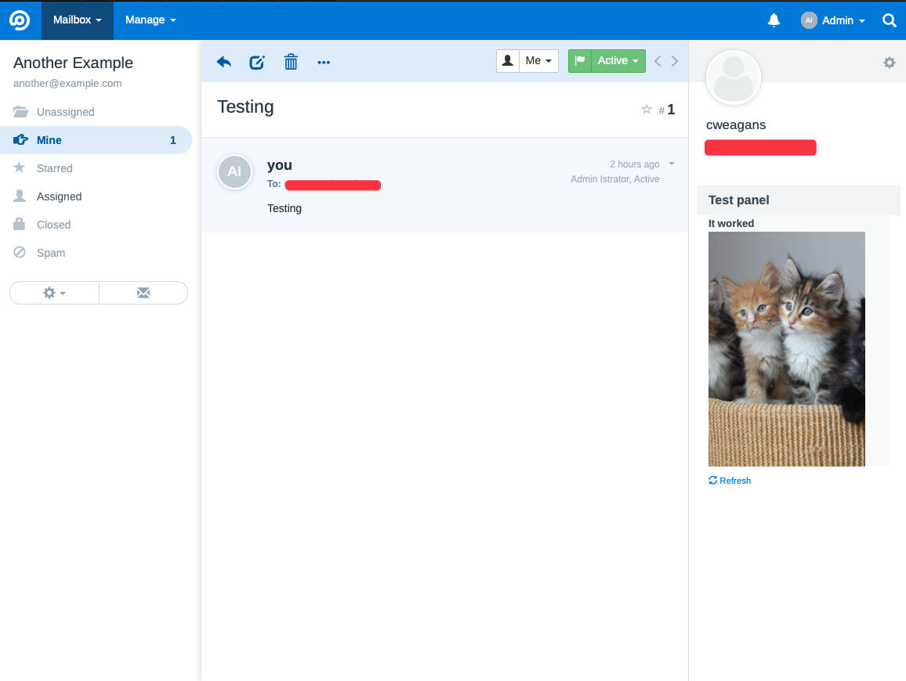
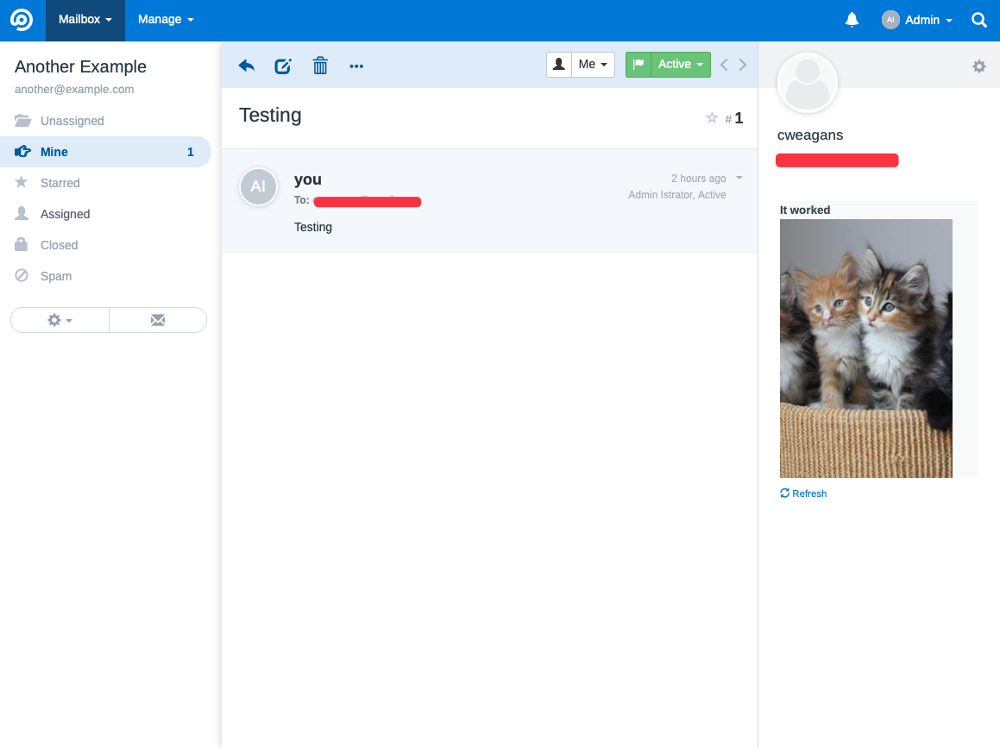

# FreeScout Sidebar Webhook

[](https://github.com/fulldecent/freescout-sidebar-webhook/actions/workflows/build-test.yml) [](https://github.com/fulldecent/freescout-sidebar-webhook/actions/workflows/lint.yml)

Sidebar Webhook asynchronously injects HTML from your server into conversation sidebars.

You can load any content on a per-customer, per-message basis from your own web server, asynchronously, every time a conversation is loaded on the screen.

In this picture, the kittens and text were loaded from an external server based on the customer's email address.




## Use cases

- Directly link to your customer management system
- Show details about order status live from your fulfillment system
- Quickly ship changes to your FreeScout system UI without updating modules
- Connect to backends using PHP, Node.js, Ruby, Perl, Rust, Go, Bash, Haskell, and Java

## Installation

These instructions assume you installed FreeScout using the [recommended process](https://github.com/freescout-helpdesk/freescout/wiki/Installation-Guide), the "one-click install" or the "interactive installation bash-script", and you are viewing this page using a macOS or Ubuntu system.

Other installations are possible, but not supported here.

1. Download `SidebarWebhook.zip` from the [latest release of FreeScout Sidebar Webhook](https://github.com/fulldecent/freescout-sidebar-webhook/releases/latest).
1. Unzip the file locally. It contains a folder named `SidebarWebhook`.
1. Copy the folder into your server using SFTP.

   ```sh
   scp -r ~/Downloads/SidebarWebhook root@freescout.example.com:/var/www/html/Modules/
   ```

1. SSH into the server and update permissions on that folder.

   ```sh
   chown -R www-data:www-data /var/www/html/Modules/SidebarWebhook/
   ```

1. Access your admin modules page, for example `https://freescout.example.com/modules/list`.
1. Find **Sidebar Webhook** and click **Activate**.
1. Configure the webhook URL in the mailbox settings. The webhook secret is optional and is sent in the payload when set.
1. After everything works, purchase a license code by sending USD 10 at <https://www.paypal.com/paypalme/fulldecent/10usd>.

## Updating

The module updates itself from your FreeScout modules page (requires FreeScout 1.8.124 or later). FreeScout checks `version.txt` of the latest GitHub release and installs its `SidebarWebhook.zip`.

Installations of version 3.2.2 or earlier still point at the old update URLs. Update those once by hand with `SidebarWebhook.zip` from the latest release (steps 1-4 above, replacing `Modules/SidebarWebhook/`). If an earlier automatic update created a `Modules/freescout-sidebar-webhook-main/` folder, delete it.

## Your webhook server

Your webhook server receives a POST request with this kind of JSON body:

```json
{
  "customerId": 123,
  "conversationSubject": "Testing this sidebar",
  "conversationType": "Phone",
  "customerEmail": "hello@example.com",
  "customerEmails": ["hello@example.com", "welcome@example.com"],
  "customerPhones": [
    {
      "n": "",
      "type": 1,
      "value": ""
    }
  ],
  "mailboxId": 1,
  "secret": "0C7DA918-E72C-47B2-923B-0C5BB6A6104E"
}
```

The field list is built by [WebhookPayload.php](WebhookPayload.php). An empty secret is sent as `""`.

Your webhook server shall respond with content to be injected into the sidebar. The document should be a complete, well-formed HTML document like so:

```html
<html>
  <body>
    <h1>Hello world</h1>
  </body>
</html>
```

You can optionally set a title in the document and it will be used as the panel title in the sidebar:

```html
<html>
  <head>
    <title>My panel title</title>
  </head>
  <body>
    <h1>Hello world</h1>
  </body>
</html>
```

Setting CORS headers is not required, as the document is requested by the FreeScout server (not by the user's browser).

## PHP versions

This module is tested on PHP 8.4 and PHP 8.5. [composer.json](composer.json) requires `php: >=8.4`. Older PHP is unsupported.

[.php-version](.php-version) is `8.5`. That is the PHP you should use locally. Continuous integration installs that version and also installs PHP 8.4, then runs the same checks on each. [shivammathur/setup-php](https://github.com/shivammathur/setup-php) installs those versions. A distribution package named `php` that ignores `.php-version` is the wrong PHP for local work.

`config.platform.php` is `8.4.99`, so `composer update` locks dependencies that still install on PHP 8.4. The production FreeScout host this module ships to runs PHP 8.4.

You will need Git, PHP 8.5, Composer 2, and the PHP extensions `dom`, `mbstring`, `tokenizer`, `xml`, and `xmlwriter`.

On Ubuntu 22.04+ or Debian 12+, install PHP 8.4 and PHP 8.5 from the [Ondřej Surý PHP archive](https://launchpad.net/~ondrej/+archive/ubuntu/php):

```sh
sudo add-apt-repository -y ppa:ondrej/php
sudo apt update
sudo apt install -y git php8.4-cli php8.4-xml php8.4-mbstring php8.4-zip php8.5-cli php8.5-xml php8.5-mbstring php8.5-zip unzip composer
sudo update-alternatives --set php /usr/bin/php8.5
```

On macOS, with Homebrew installed:

```sh
brew install git php@8.4 php@8.5 composer
brew link --overwrite --force php@8.5
```

[php@8.5](https://formulae.brew.sh/formula/php) stays on PHP 8.5. Homebrew's unversioned `php` formula moves to the next release on its own, so it will not keep matching [.php-version](.php-version).

## Testing

Work from the project directory.

```sh
composer install
composer test
composer check
```

`composer test` runs PHPUnit. `composer check` runs PHP-CS-Fixer in dry-run mode and PHPStan at level 9. PHPStan covers [WebhookPayload.php](WebhookPayload.php) and [tests](tests). The FreeScout controller, routes, and service provider run inside FreeScout, where those classes exist, so they are formatted with PHP-CS-Fixer and left out of PHPStan.

Apply PHP-CS-Fixer when it reports a diff:

```sh
vendor/bin/php-cs-fixer fix
```

Correct formatting before you send a pull request:

```sh
npx prettier@latest --check . --write
npx markdownlint-cli@latest "**/*.md" --fix
```

Composer puts install outputs in the ignored `vendor/` directory. Packed releases go in the ignored `dist/` directory.

## Releases

Use `fix:`, `feat:`, or `BREAKING CHANGE:` in your commit messages. This triggers our bot to make a release draft pull request. Merging that pull request triggers a new tag and GitHub Release.

The [release workflow](.github/workflows/release.yml) uses Release Please's `simple` release type through [release-please-config.json](release-please-config.json). That file exists so the release pull request bumps `version` in [module.json](module.json) as well as [version.txt](version.txt). Do not add a `version` field to [composer.json](composer.json). The tag is the version, with a leading `v`. `version.txt` and `module.json` use the same number without the `v`, because FreeScout compares those two strings.

A commit on `main` whose message starts with `fix:` opens or updates a release pull request that bumps the patch version. `feat:` bumps the minor version. `BREAKING CHANGE:` bumps the major version. One release pull request collects every such commit since the last `v` tag. A commit with any other prefix, including `chore:` and `docs:`, does not open that pull request. Merging the release pull request is the release. Release Please writes [CHANGELOG.md](CHANGELOG.md) in that pull request and does not create the tag. The publish job creates the tag.

[Build and test](.github/workflows/build-test.yml) runs the checks on PHP 8.4 and PHP 8.5, packs `SidebarWebhook.zip` and `version.txt`, then attests and uploads them. The release includes those two files and `release.sigstore.jsonl`. The zip filename has no version in it. The version is the tag, and the attestation records that version without a leading `v`.

FreeScout downloads `SidebarWebhook.zip` and `version.txt` from the latest GitHub release. The zip's root folder is `SidebarWebhook/`. This is not a Packagist package.

Tags before 3.3.0 have no `v` prefix. `v3.2.2` points at the same commit as `3.2.2`, which is the version Release Please counts forward from.

> [!NOTE]
> In your GitHub repository settings, under Actions, General, Workflow permissions, select read and write permissions and check "Allow GitHub Actions to create and approve pull requests". Under General, Releases, enable release immutability. Attestations are available for public repositories; private repositories require GitHub Enterprise Cloud.

## Maintenance

The project administrator completes these maintenance tasks each month. If they are 3+ months late, please remind them or send your own issue or pull request.

1. Identify external Actions in [.github/workflows](.github/workflows) and look for available new versions. Review and update them if it is safe. GitHub-supported Actions (under the actions/ organization) may require only cursory review. [shivammathur/setup-php](https://github.com/shivammathur/setup-php) and [googleapis/release-please-action](https://github.com/googleapis/release-please-action) are not in that organization, so read their changelogs.
1. Review PHP 8.4 and PHP 8.5 in [.github/workflows/build-test.yml](.github/workflows/build-test.yml), the version in [.php-version](.php-version), and the `php` constraint in [composer.json](composer.json). Update the PHP versions section when that set changes. `8.4` means the newest PHP 8.4 patch, and `8.5` means the newest PHP 8.5 patch.
1. Review direct dependencies with `composer outdated --direct`.

## Project scope

Our goal is to have a very simple module to allow vast extensibility in the conversation sidebar.

Anything that makes it simpler (removes unneeded code) or more extensible for most people (adding a couple of post parameters in `boot()`) will be a welcome improvement.

## Troubleshooting

Hints:

- Class `Modules\SidebarWebhook\Providers\SidebarWebhookServiceProvider` not found. Did you rename the folder as described in installation step 3?

If something is not working, please try these steps so we can see what is wrong.

1. Update FreeScout to the latest version (even if the new version doesn't have any relevant changes, the process of updating can sometimes fix problems that would prevent this module from running).
1. Use `chown -R` to ensure the module has the same owner and permissions as other files in your FreeScout installation.
1. Try to disable and re-enable Sidebar Webhook from your modules page.
1. To confirm the module file is actually activated and readable you might add a line like this above the `private const MODULE_NAME` line. The code to add is `file_put_contents("/tmp/sidebartmp", "is running");`. Then load a conversation and see if that file is created.
1. Next check the system logs. Warnings, errors, or notices may show where the problem is coming from.
1. Check your PHP version. This module supports PHP 8.4 and PHP 8.5.

After you have checked all these things, please create an issue and detail how you tried each of these steps.

## References

1. We use title case only for proper nouns, including the name of this project.
1. [PSR-12](https://www.php-fig.org/psr/psr-12/) is why `*.php` uses four spaces in [.editorconfig](.editorconfig). Other files do not set an indent size.
1. [composer.json `version`](https://getcomposer.org/doc/04-schema.md#version) is omitted. The git tag is the version. [composer.lock](composer.lock) is committed so CI is reproducible ([Composer: commit your lock file](https://getcomposer.org/doc/01-basic-usage.md#commit-your-composer-lock-file-to-version-control)). `git archive` leaves that lock file out.
1. This project is built based on [best practices documented in php-package-template](https://github.com/fulldecent/php-package-template/), release v1.1.1.
1. The floor for the README, the lint workflow, and the release workflow comes from [project-template](https://github.com/fulldecent/project-template), release v1.4.1.
1. The Composer ignore rules in [.gitignore](.gitignore) come from [GitHub's Composer gitignore](https://github.com/github/gitignore/blob/main/Composer.gitignore).
1. FreeScout module installation follows the [FreeScout installation guide](https://github.com/freescout-helpdesk/freescout/wiki/Installation-Guide). The updater reads `version.txt` and `SidebarWebhook.zip` from the latest GitHub release, which is why those two files are the release assets.
1. This project was inspired by [Sidebar API](https://github.com/scout-devs/SidebarApi).
1. This project is released under the [MIT license](LICENSE.md).
